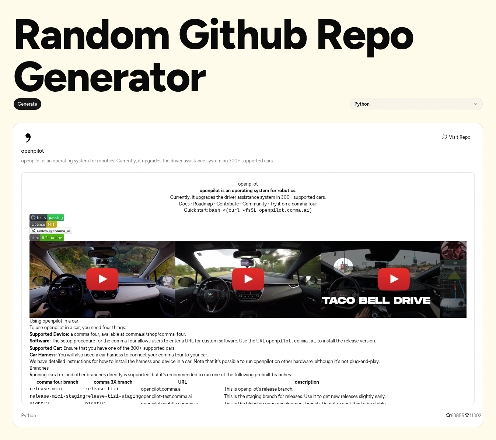

# Random GitHub Repo Generator

A small SvelteKit app that discovers a random GitHub repository based on a programming language selected by the user. It uses GitHub's repository search API and displays repository details, including its description, language, stars, forks, and README preview.



## Features

- Select a programming language from a searchable language selector.
- Find a random repository from GitHub search results for the selected language.
- View repository details, including its description, language, stars, and forks.
- Open the repository directly on GitHub.
- Preview the repository's README as rendered Markdown.
- Display loading and error states while fetching repository information.

> The random selection is made from the search results returned by GitHub; it does not sample every repository on GitHub uniformly.

## Built with

- [SvelteKit](https://svelte.dev/docs/kit) — application framework.
- [Svelte 5](https://svelte.dev/docs/svelte/overview) — reactive UI and component state.
- [TypeScript](https://www.typescriptlang.org/) — type checking.
- [Tailwind CSS](https://tailwindcss.com/) — utility-first styling.
- [shadcn-svelte](https://www.shadcn-svelte.com/) — UI components such as Button, Card, Command, and Popover.
- [Lucide](https://lucide.dev/) — interface icons.
- [Hugeicons](https://hugeicons.com/) — GitHub icon.
- [SvelteMarkdown](https://github.com/Human-Being/svelte-markdown) — Markdown rendering for repository READMEs.
- [GitHub REST API](https://docs.github.com/en/rest/search/search#search-repositories) — repository search.
- [GitHub README API](https://docs.github.com/en/rest/repos/contents#get-a-repository-readme) — README content.

## Project structure

The exact file layout may differ depending on how the project was created. A typical structure for this app is:

```text
RandomGitgen/
├── static/
│   └── screenshot.png
├── src/
│   ├── lib/
│   │   ├── components/
│   │   │   └── ui/
│   │   │       ├── button/
│   │   │       ├── card/
│   │   │       ├── command/
│   │   │       └── popover/
│   │   ├── languages.json
│   │   └── utils/
│   │       └── ...
│   └── routes/
│       ├── +layout.svelte
│       ├── +page.svelte
│       ├── Repo.svelte
│       └── Selector.svelte
├── package.json
├── svelte.config.js
├── vite.config.ts
├── tsconfig.json
└── README.md
```

SvelteKit projects commonly place route components inside `src/routes/`. If `Repo.svelte` and `Selector.svelte` are currently elsewhere in your project, keep your actual paths or move them only after updating imports.

## Run locally

### Requirements

- Node.js (use a current LTS release).
- npm.
- Internet access to call the GitHub API.

### 1. Clone your repository

Replace the URL below with your own GitHub repository URL:

```bash
git clone https://github.com/YOUR_USERNAME/RandomGitgen.git
cd RandomGitgen
```

If the project is already on your computer, just open a terminal in its root directory.

### 2. Install dependencies

```bash
npm install
```

### 3. Start the development server

```bash
npm run dev
```

Open the local URL printed in the terminal, commonly `http://localhost:5173`.

### 4. Check the production build

```bash
npm run check
npm run build
```

If your `package.json` does not define the `check` script, inspect its `scripts` section and use the available validation command.

## Deploy / host the app

### Option A: Vercel

1. Push the project to GitHub.
2. Sign in to [Vercel](https://vercel.com/) and import the repository.
3. Configure the project using the settings appropriate for your SvelteKit adapter.
4. Deploy and open the generated URL.

For SvelteKit, follow the official [Vercel adapter guide](https://svelte.dev/docs/kit/adapter-vercel) if the platform does not configure the adapter automatically.

### Option B: Netlify

1. Push the project to GitHub.
2. Import the repository in [Netlify](https://www.netlify.com/).
3. Follow the official [Netlify adapter guide](https://svelte.dev/docs/kit/adapter-netlify) and configure the build settings.
4. Deploy and test the published URL.

### Hosting on your own computer or server

For a quick local preview of the production build:

```bash
npm run build
npm run preview
```

The preview server is intended for checking the production build, not as a complete production hosting setup. To expose the app publicly from your own server, configure the appropriate SvelteKit adapter, a production process manager, HTTPS, and any required reverse proxy.

## How it works

1. The user chooses a language.
2. Clicking **Generate** starts a GitHub repository search for that language.
3. The app chooses one repository randomly from the returned results.
4. Repository details are shown in a card.
5. The app requests the repository's README and renders it as Markdown when available.

GitHub API requests can be rate-limited. The app should display a helpful message if a request fails or the selected language has no matching results.

## Credits and acknowledgements

- **GitHub** — repository search and README data through the GitHub REST API.
- **Svelte and SvelteKit** — application framework and reactive components.
- **Tailwind CSS** — styling utilities.
- **shadcn-svelte** — reusable UI component patterns.
- **Lucide and Hugeicons** — icons.
- **SvelteMarkdown** — README Markdown rendering.
- **OpenAI ChatGPT** — assistance with implementation guidance, TypeScript/Svelte debugging, API integration, and documentation drafting.

This project is an independent learning project and is not affiliated with or endorsed by GitHub. Product names and logos belong to their respective owners.
