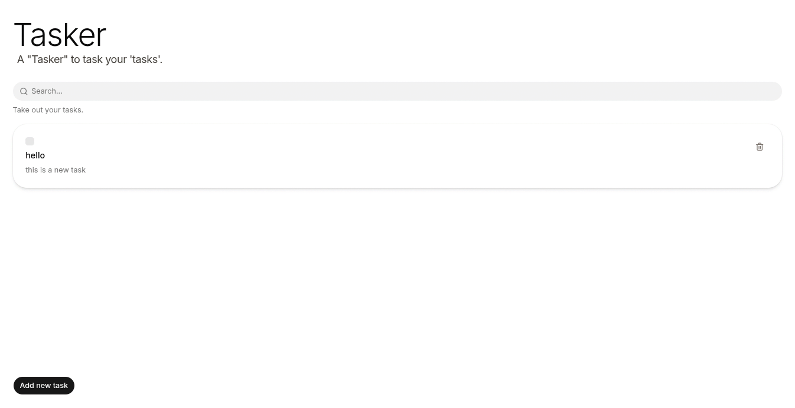

# Tasker

A minimal, clean task manager built with **SvelteKit** and **TypeScript**. Add, search, mark as complete, and delete your tasks - all stored locally in your browser using `localStorage`. Simple as that: *A "Tasker" to task your 'tasks'.*



---

## Table of Contents

- [Tech Stack & Dependencies](#tech-stack--dependencies)
- [Project Structure](#project-structure)
- [Prerequisites](#prerequisites)
- [Getting Started](#getting-started)
- [Available Scripts](#available-scripts)
- [Type Checking](#type-checking)
- [Features](#features)
- [Hosting / Deployment Guide](#hosting--deployment-guide)
  - [Vercel](#vercel)
  - [Netlify](#netlify)
  - [Cloudflare Pages (Workers)](#cloudflare-pages-workers)
  - [Docker](#docker)
  - [Node.js / Static Server](#nodejs--static-server)
- [License](#license)

---

## Tech Stack & Dependencies

| Area | Technology | Version | Package | Credit |
| --- | --- | --- | --- | --- |
| Framework | [Svelte](https://svelte.dev/) | 5.x | `svelte` | [sveltejs](https://github.com/sveltejs) |
| Framework | [SvelteKit](https://svelte.dev/kit) | 3.x | `@sveltejs/kit` | [sveltejs](https://github.com/sveltejs) |
| Build tool | [Vite](https://vitejs.dev/) | 8.x | `vite` | [vitejs](https://github.com/vitejs/vite) |
| Language | [TypeScript](https://www.typescriptlang.org/) | 6.x | `typescript` | Microsoft |
| Styling | [Tailwind CSS v4](https://tailwindcss.com/) + [@tailwindcss/vite](https://github.com/tailwindlabs/tailwindcss) | 4.x | `tailwindcss`, `@tailwindcss/vite` | [Tailwind Labs](https://github.com/tailwindlabs) |
| Typography | [@tailwindcss/typography](https://github.com/tailwindlabs/tailwindcss-typography) | 0.x | `@tailwindcss/typography` | [Tailwind Labs](https://github.com/tailwindlabs) |
| UI components | [shadcn-svelte](https://shadcn-svelte.com/) (bits-ui, cn, tailwind-variants, tw-animate-css) | 1.x | `shadcn-svelte` | [shadcn-svelte](https://github.com/shadcn-svelte) |
| className utils | [cn](https://github.com/node-modules/cn) | 0.x | `cn` | [node-modules](https://github.com/node-modules) |
| Tailwind variants | [tailwind-variants](https://github.com/bobbyruddata/tailwind-variants) | 3.x | `tailwind-variants` | [bobbyruddata](https://github.com/bobbyruddata) |
| CSS animation | [tw-animate-css](https://github.com/CTDarkur/ts-animate-css) | 1.x | `tw-animate-css` | [CTDarkur](https://github.com/CTDarkur) |
| Icons | [@lucide/svelte](https://lucide.dev/) | 1.x | `@lucide/svelte` | [Lucide](https://github.com/lucide-icons) |
| Toasts | [svelte-sonner](https://github.com/wobsoriano/svelte-sonner) | 1.x | `svelte-sonner` | [wobsoriano](https://github.com/wobsoriano) |
| Theme | [mode-watcher](https://github.com/svecosystem/mode-watcher) | 1.x | `mode-watcher` | [Svecosystem](https://github.com/svecosystem) |
| Date handling | [@internationalized/date](https://www.npmjs.com/package/@internationalized/date) | 3.x | `@internationalized/date` | Adobe |
| Fonts | [@fontsource-variable/inter](https://fontsource.org/) | 5.x | `@fontsource-variable/inter` | [Fontsource](https://github.com/fontsource-org) |
| SvelteKit adapter | [@sveltejs/adapter-auto](https://github.com/sveltejs/adapters) | 8.x | `@sveltejs/adapter-auto` | [sveltejs](https://github.com/sveltejs) |

### Development dependencies (`devDependencies`)

```json
{
  "@fontsource-variable/inter": "^5.3.0",
  "@internationalized/date": "^3.12.4",
  "@lucide/svelte": "^1.62.0",
  "@sveltejs/adapter-auto": "^8.0.0",
  "@sveltejs/kit": "^3.0.0",
  "@sveltejs/vite-plugin-svelte": "^7.2.0",
  "@tailwindcss/typography": "^0.5.4",
  "@tailwindcss/vite": "^4.3.0",
  "bits-ui": "^2.20.2",
  "cn": "^0.5.0",
  "mode-watcher": "^1.1.0",
  "shadcn-svelte": "^1.7.1",
  "svelte": "^5.57.1",
  "svelte-check": "^4.6.0",
  "svelte-sonner": "^1.2.2",
  "tailwind-variants": "^3.3.1",
  "tailwindcss": "^4.3.0",
  "tw-animate-css": "^1.4.0",
  "typescript": "^6.0.3",
  "vite": "^8.3.0"
}
```

### Path aliases

This project uses custom import aliases (see `package.json`):

```json
{
  "imports": {
    "#lib": "./src/lib/index.js",
    "#lib/*": "./src/lib/*"
  }
}
```

All internal imports use `#lib/` instead of `$lib/` for consistency.

---

## Project Structure

```
tasker/
├── .svelte-kit/              # SvelteKit generated files (auto-generated)
├── node_modules/             # Project dependencies
├── src/
│   ├── app.html              # HTML template
│   ├── app.d.ts              # TypeScript global declarations
│   ├── routes/
│   │   ├── +layout.svelte    # Root layout (with Toaster)
│   │   ├── +page.svelte      # Main tasker page
│   │   └── layout.css        # Global styles (Tailwind + shadcn theme)
│   └── lib/
│       ├── assets/
│       │   └── favicon.svg
│       ├── components/
│       │   └── ui/           # shadcn-svelte UI components
│       │       ├── button/
│       │       ├── card/
│       │       ├── checkbox/
│       │       ├── dialog/
│       │       ├── field/
│       │       ├── input/
│       │       ├── input-group/
│       │       ├── label/
│       │       ├── separator/
│       │       └── sonner/
│       ├── hooks/            # SvelteKit hooks
│       ├── index.ts          # #lib alias barrel file
│       └── utils.ts          # Utility functions (cn export + helpers)
├── static/                   # Static assets
├── .gitignore
├── .npmrc                  # npm config (engine-strict)
├── .vscode/
│   ├── extensions.json        # Recommended VS Code extensions
│   └── settings.json          # VS Code settings
├── components.json            # shadcn-svelte config (style: luma)
├── package.json
├── package-lock.json
├── tsconfig.json
└── vite.config.ts            # Vite config (Tailwind + SvelteKit + adapter-auto)
```

---

## Prerequisites

- **Node.js** >= 20.0.0
- **npm** (comes with Node.js) or a compatible package manager

---

## Getting Started

### 1. Clone the repository

```bash
git clone https://github.com/<your-username>/tasker.git
cd tasker
```

### 2. Install dependencies

```bash
npm install
```

### 3. Start the development server

```bash
npm run dev
```

This starts the Vite dev server at `http://localhost:5170` (or the next available port).

To automatically open the app in your browser:

```bash
npm run dev -- --open
```

### 4. Start tasking

Head to the app, add your first task, and start ticking them off!

---

## Available Scripts

| Command | Description |
| --- | --- |
| `npm run dev` | Start the Vite development server |
| `npm run build` | Build the project for production (using adapter-auto) |
| `npm run preview` | Preview the production build locally |
| `npm run check` | Run `svelte-check` for type checking |
| `npm run check:watch` | Run type checking in watch mode |
| `npm run prepare` | Sync SvelteKit (runs automatically before install) |

---

## Features

- **Add tasks** - Quickly add a new task with a name and description via the dialog
- **Mark as complete** - Check off completed tasks with strike-through styling
- **Delete tasks** - Remove tasks you no longer need
- **Search tasks** - Filter your task list in real-time by task name
- **Persistent storage** - All tasks are saved in `localStorage`, so they persist across sessions
- **Toast notifications** - Get feedback when adding tasks or hitting validation
- **Responsive design** - Clean, minimal UI that works on desktop and mobile
- **Loading & error states** - Graceful handling when reading from localStorage

---

## License

MIT