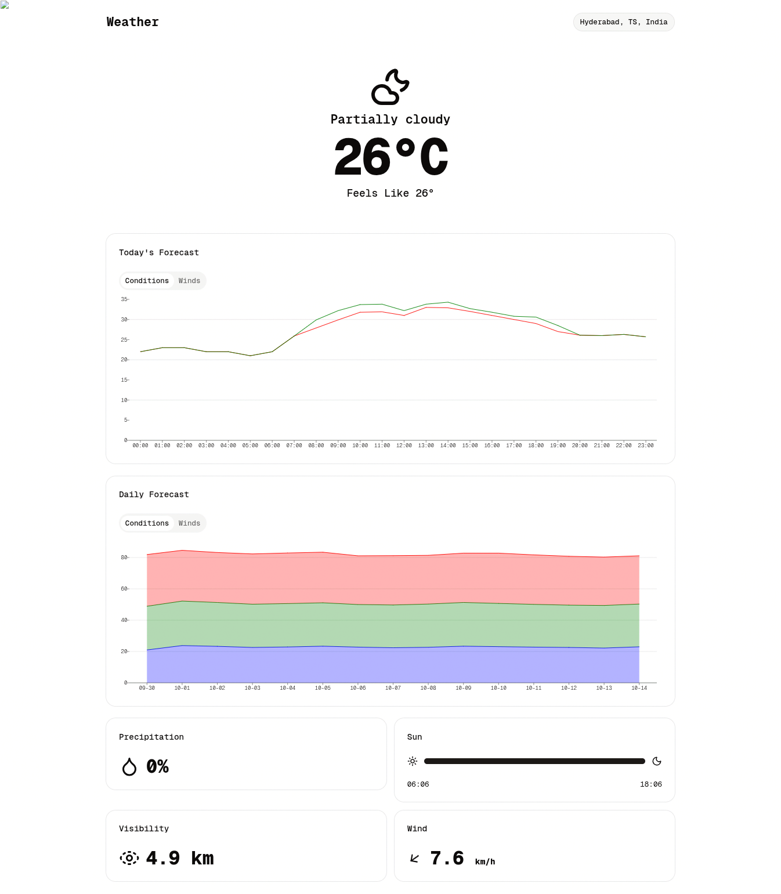

# Weather

A clean, responsive weather application built with **SvelteKit** and **TypeScript**. It shows current conditions, hourly/daily forecasts, wind direction, precipitation, and sunrise/sunset progress, using the [Visual Crossing Weather API](https://www.visualcrossing.com/weather).



---

## Table of Contents

- [Tech Stack & Dependencies](#tech-stack--dependencies)
- [Project Structure](#project-structure)
- [Prerequisites](#prerequisites)
- [Getting Started](#getting-started)
- [Environment Variables](#environment-variables)
- [Available Scripts](#available-scripts)
- [Type Checking](#type-checking)
- [Hosting / Deployment Guide](#hosting--deployment-guide)
  - [Vercel](#vercel)
  - [Netlify](#netlify)
  - [Cloudflare Pages (Workers)](#cloudflare-pages-workers)
  - [Docker](#docker)
  - [Node.js / Static Server](#nodejs--static-server)
- [Secrets Management](#secrets-management)
- [License](#license)

---

## Tech Stack & Dependencies

| Area | Technology | Version | Package | Credit |
| --- | --- | --- | --- | --- |
| Framework | [Svelte](https://svelte.dev/) | 5.x | `svelte` | [sveltejs](https://github.com/sveltejs) |
| Framework | [SvelteKit](https://svelte.dev/kit) | 2.x | `@sveltejs/kit` | [sveltejs](https://github.com/sveltejs) |
| Build tool | [Vite](https://vitejs.dev/) | 8.x | `vite` | [vitejs](https://github.com/vitejs/vite) |
| Language | [TypeScript](https://www.typescriptlang.org/) | 6.x | `typescript` | Microsoft |
| Styling | [Tailwind CSS v4](https://tailwindcss.com/) + [@tailwindcss/vite](https://github.com/tailwindlabs/tailwindcss) | 4.x | `tailwindcss`, `@tailwindcss/vite` | [Tailwind Labs](https://github.com/tailwindlabs) |
| UI components | [shadcn-svelte](https://shadcn-svelte.com/) | 1.x | `shadcn-svelte` | [shadcn-svelte](https://github.com/shadcn-svelte) |
| className utils | [cn](https://github.com/node-modules/cn) | 0.x | `cn` | [node-modules](https://github.com/node-modules) |
| Tailwind variants | [tailwind-variants](https://github.com/bobbyruddata/tailwind-variants) | 3.x | `tailwind-variants` | [bobbyruddata](https://github.com/bobbyruddata) |
| CSS animation | [tw-animate-css](https://github.com/CTDarkur/ts-animate-css) | 1.x | `tw-animate-css` | [CTDarkur](https://github.com/CTDarkur) |
| Icons | [@lucide/svelte](https://lucide.dev/) | 1.x | `@lucide/svelte` | [Lucide](https://github.com/lucide-icons) |
| Charts | [layerchart](https://layerchart.dev/) | 2.x | `layerchart` | [layerchart](https://github.com/layerchart) |
| Animation | [@humanspeak/svelte-motion](https://www.npmjs.com/package/@humanspeak/svelte-motion) | 1.x | `@humanspeak/svelte-motion` | [humanspeak](https://github.com/humanspeak) |
| Fonts | [@fontsource-variable/geist-mono](https://fontsource.org/) | 5.x | `@fontsource-variable/geist-mono` | [Fontsource](https://github.com/fontsource-org) |
| Date handling | [@internationalized/date](https://www.npmjs.com/package/@internationalized/date) | 3.x | `@internationalized/date` | Adobe |
| SvelteKit adapter | [@sveltejs/adapter-auto](https://github.com/sveltejs/adapters) | 7.x | `@sveltejs/adapter-auto` | [sveltejs](https://github.com/sveltejs) |
| Weather data API | [Visual Crossing Weather API](https://www.visualcrossing.com/weather/) | — | — | [Visual Crossing](https://www.visualcrossing.com/) |

### Production dependencies (`dependencies`)

```json
{
  "@humanspeak/svelte-motion": "^1.4.6",
  "env": "^0.0.2",
  "layerchart": "^2.5.0",
}
```

### Development dependencies (`devDependencies`)

```json
{
  "@fontsource-variable/geist-mono": "^5.3.0",
  "@internationalized/date": "^3.12.4",
  "@lucide/svelte": "^1.48.0",
  "@sveltejs/adapter-auto": "^7.0.1",
  "@sveltejs/kit": "^2.63.0",
  "@sveltejs/vite-plugin-svelte": "^7.1.2",
  "@tailwindcss/vite": "^4.3.0",
  "bits-ui": "^2.19.3",
  "cn": "^0.4.0",
  "shadcn-svelte": "^1.7.0",
  "svelte": "^5.56.1",
  "svelte-check": "^4.6.0",
  "tailwind-variants": "^3.3.1",
  "tailwindcss": "^4.3.0",
  "tw-animate-css": "^1.4.0",
  "typescript": "^6.0.3",
  "vite": "^8.0.16",
}
```

---

## Project Structure

```
weather/
├── .svelte-kit/              # SvelteKit generated files (auto-generated)
├── node_modules/             # Project dependencies
├── src/
│   ├── app.html              # HTML template
│   ├── app.d.ts              # TypeScript global declarations
│   ├── routes/
│   │   ├── +layout.svelte    # Root layout
│   │   ├── +page.svelte      # Main weather page
│   │   ├── layout.css        # Global styles (Tailwind + shadcn theme)
│   │   ├── Chart.svelte      # Line/Area chart component (layerchart)
│   │   ├── LocationPopOver.svelte  # Location search popover
│   │   ├── Tabs.svelte       # Hourly/Daily tabs container
│   │   ├── WeatherIcon.svelte # Weather condition icon component
│   │   └── WindTab.svelte    # Wind direction/speed scrollable tab
│   └── lib/
│       ├── assets/
│       │   └── favicon.svg
│       ├── components/
│       │   └── ui/           # shadcn-svelte UI components
│       │       ├── button/
│       │       ├── card/
│       │       ├── input/
│       │       ├── label/
│       │       ├── popover/
│       │       ├── progress/
│       │       ├── scroll-area/
│       │       └── tabs/
│       ├── hooks/            # SvelteKit hooks (empty)
│       ├── env.ts            # Environment variable reader
│       ├── index.ts          # $lib alias barrel file
│       └── utils.ts          # Utility functions (cn export)
├── static/
│   └── robots.txt
├── .env                      # Local environment (gitignored)
├── .env.example              # Example environment file
├── .gitignore
├── .npmrc                  # npm config (engine-strict)
├── .vscode/
│   ├── extensions.json        # Recommended VS Code extensions
│   └── settings.json          # VS Code settings
├── components.json            # shadcn-svelte config
├── package.json
├── package-lock.json
├── tsconfig.json
└── vite.config.ts            # Vite config (Tailwind + SvelteKit + adapter)
```

---

## Prerequisites

- **Node.js** >= 20.0.0
- **npm** (comes with Node.js) or a compatible package manager
- A **Visual Crossing Weather API key** (free tier available)

---

## Getting Started

### 1. Clone the repository

```bash
git clone https://github.com/<your-username>/weather.git
cd weather
```

### 2. Install dependencies

```bash
npm install
```

### 3. Configure environment variables

```bash
cp .env.example .env
```

Open `.env` and add your Visual Crossing API key:

```env
VITE_WEATHER_API_KEY=your_api_key_here
```

> Get a free API key at [https://www.visualcrossing.com/weather](https://www.visualcrossing.com/weather).

### 4. Start the development server

```bash
npm run dev
```

This starts the Vite dev server at `http://localhost:5170` (or the next available port).

To automatically open the app in your browser:

```bash
npm run dev -- --open
```

---

## Environment Variables

The app reads the Visual Crossing API key from an environment variable:

| Variable | Description | Required |
| --- | --- | --- |
| `VITE_WEATHER_API_KEY` | Visual Crossing Weather API key | Yes |

The key is read centrally in `src/lib/env.ts` and imported wherever needed:

```ts
// src/lib/env.ts
const API_KEY = import.meta.env.VITE_WEATHER_API_KEY as string | undefined;

if (!API_KEY) {
    throw new Error(
        'Missing VITE_WEATHER_API_KEY. Copy .env.example to .env and add your Visual Crossing API key.'
    );
}

export const WEATHER_API_KEY = API_KEY;
```

Usage in components:

```ts
import { WEATHER_API_KEY } from "$lib/env";
```

> **Note:** The `.env` file is gitignored. Never commit your real API key to version control.

---

## Available Scripts

| Command | Description |
| --- | --- |
| `npm run dev` | Start the Vite development server |
| `npm run build` | Build the project for production (using adapter-auto) |
| `npm run preview` | Preview the production build locally |
| `npm run check` | Run `svelte-check` for type checking |
| `npm run check:watch` | Run type checking in watch mode |
| `npm run prepare` | Sync SvelteKit (runs automatically before install) |

---

## License

MIT
